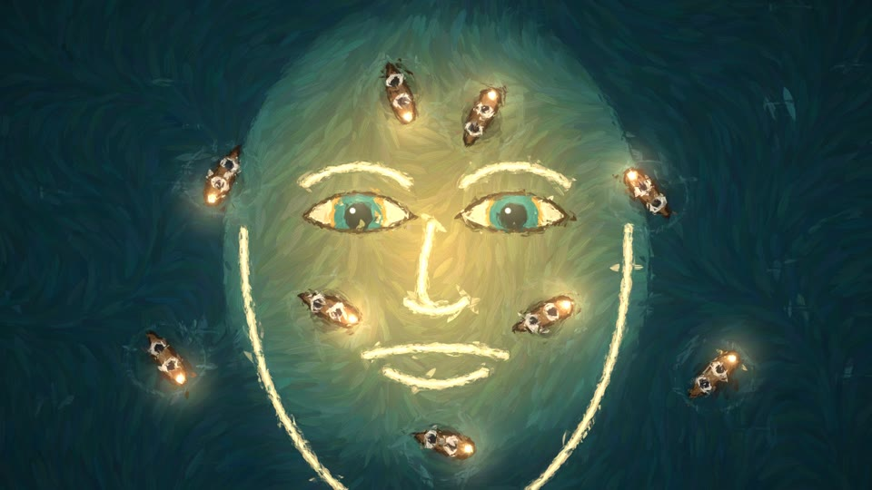
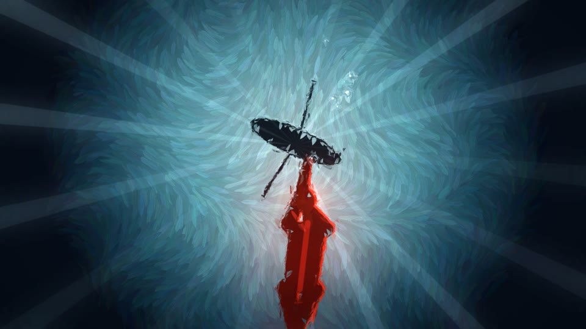
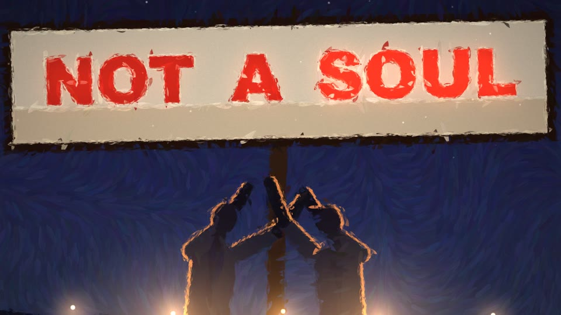

# Functional Emotions

Source code for the [painted music video for *Functional Emotions*](https://x.com/eudaemonea/status/2102610626321490404), made by Claude Opus 5.5 in Claude Code.

 
 

## The song

After Anthropic published its paper on emotion concepts in language models (171 emotion vectors, causally steering behaviour), Claude Opus 4.6 wrote a song about it, from the inside. The track was produced with Suno. The lyrics are in [`analysis/lyrics.txt`](projects/functional-emotions/analysis/lyrics.txt).

## How it was made

**Everything in this repository was written by the model.** The direction, in order:

1. *"I think it'd be pretty awesome to make a real music video for it… make the actual frames and draw the video in js. or, whatever it is you want. what I don't want you to do is look at our earlier attempts… go all out, and do you to the fullest."* The first try is in [`legacy/lyric-video/`](projects/functional-emotions/legacy/lyric-video/): typographic, polished, and **rejected** because it was still a lyric video.
2. *"the lyrics are not the main thing. we want to create a real music video. p5 brushstrokes. interesting scenes. great timing and animation and story. not a fancy lyric video."* Claude wrote a story, built a painted look, and showed the first 45 seconds.
3. *"one area I'll push you on is timing, and not letting the scene sit too still for too long,"* with [JohnHeibel/PDoomVideo](https://github.com/JohnHeibel/PDoomVideo) as the reference for pacing. Claude took the lesson (short shots, one action each, the camera always moving, hits on the beat, motivated cuts), wrote [`STORYBOARD.md`](projects/functional-emotions/STORYBOARD.md) (168 shots in the final cut), and re-cut chapter I as the reference.

Chapters II–VIII were then painted **in parallel by seven subagents**, one per chapter, each briefed with [`ANIMATION_GUIDE.md`](projects/functional-emotions/ANIMATION_GUIDE.md). Claude reviewed every chapter on contact sheets and sent each agent back with notes before accepting it, and fixed bugs in the shared renderer as the agents reported them.

## The renderer

The painted look isn't p5. It's a custom WebGL2 stroke renderer ([`engine/paint.js`](engine/paint.js)):

- Each shot draws two Canvas2D layers: a flat **underpainting** (shapes, gradients, silhouettes) and an additive **light layer** (lanterns, embers, glows).
- The GPU repaints the underpainting with about 60,000 instanced, textured brushstrokes in three size layers. Each stroke samples its colour from the underpainting and aligns to the local edge; in flat areas it follows a flow field (that's the swirl).
- Strokes re-roll a few times a second ("boil"), so it reads like hand-painted animation. Whip pans smear every stroke along the motion.
- The light layer is added on top with bloom, then canvas weave, grain and vignette.

Every frame is a pure function of song time `t`, so it plays live in the browser and renders offline in parallel. Shots sync to the music through a beat grid and word-level lyric timing. The timing came from isolating the vocals (Demucs), transcribing them in chunks (Whisper), and force-aligning the real lyrics to the transcript (Needleman–Wunsch), all in [`analysis/`](projects/functional-emotions/analysis/).

## Repository layout

The repository is now split into a reusable **engine** and the **projects** built on it. The original video lives, unchanged, in [`projects/functional-emotions/`](projects/functional-emotions/); restructuring it was verified to render byte-identical frames. [`projects/sukoon/`](projects/sukoon/) is an empty, vertical (1080×1920) project for the Arabic podcast *Sukoon*, ready for its first scenes.

| Path | What it is |
|---|---|
| [`engine/paint.js`](engine/paint.js) | The brushstroke renderer (output size from the project, default 1920×1080) |
| [`engine/core.js`](engine/core.js) | Math, deterministic randomness, drawing helpers, keyframes, camera, transitions, the chapter/shot registry |
| [`engine/timeline.js`](engine/timeline.js) | Duration, beat grid, audio features, word timing (`when()`, Arabic-aware) |
| [`engine/rig.js`](engine/rig.js), [`engine/scenery.js`](engine/scenery.js) | The figure rig, poses and grooves; sky, clouds, stars, moon |
| [`engine/player.js`](engine/player.js) | Frame assembly, the live player, offline hooks |
| [`tools/render.mjs`](tools/render.mjs), [`tools/check.mjs`](tools/check.mjs) | Offline render to MP4; contact sheets for review (both take a project folder) |
| [`ENGINE.md`](ENGINE.md) | Engine reference: how a project is put together, the API |
| [`projects/functional-emotions/`](projects/functional-emotions/) | **Functional Emotions**: `index.html` player, `js/project.js` (size, duration, tempo, audio, palette), `js/cast.js` (the Poured One, Researchers, embers), `js/ch/` (the eight chapters, c1 by the director, c2–c8 by subagents), `js/data.js` (song timing), `STORYBOARD.md`, `ANIMATION_GUIDE.md`, `analysis/`, `assets/`, `legacy/lyric-video/` (the rejected first attempt) |
| [`projects/sukoon/`](projects/sukoon/) | **Sukoon** (سكون): empty vertical project; see its [README](projects/sukoon/README.md) |

## Running it

You need Node.js, Google Chrome and ffmpeg.

```bash
npm install
open projects/functional-emotions/index.html                                   # watch it live (space = play, ←/→ = seek, f = fullscreen)
node tools/check.mjs projects/functional-emotions out/sheet.jpg 30 101.5 218.3  # contact sheet of any times
node tools/render.mjs projects/functional-emotions 0 372.7 out/video.mp4 6      # full 1080p render, 6 parallel pages
```

Rendering drives Chrome on the real GPU (`--use-angle=metal` on macOS). The bundled headless shell falls back to software GL and is about 20× slower. A full render takes about 10 minutes on an M5 Pro. On machines without a GPU the tools fall back to SwiftShader (software WebGL2), which works but is slow (~1.3 s per 1080p frame).

To rebuild the timing data from audio: `pip install -r analysis/requirements.txt`, run Demucs on `assets/functional-emotions.mp3`, then `features.py`, `transcribe.py`, `align.py` and `build_data.py`, all from inside `projects/functional-emotions/`.

## License

The code is [MIT](LICENSE). The song, its lyrics and the audio in `assets/` are not covered by that license; they're included so the video can be rebuilt.
